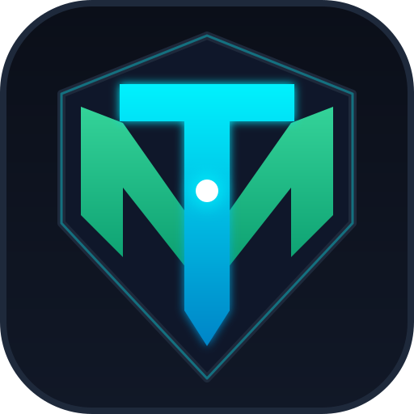

<p align="center">
  
</p>

<h1 align="center">TMAegis™ (<code>tmaegis</code>)</h1>

<p align="center">
  
  
  
  
  
  
</p>

> **Public beta (0.1.0).** TMAegis is usable today but still maturing. Try it on a test machine first and run `tmaegis apply --dry-run` before changing production systems. Versions stay `0.x` until 1.0.0, so behaviour and flags may still change between 0.x releases.

**Autonomous CIS Hardening & Security Compliance Engine — AI-Powered Cross-Platform Hardening for SysOps, DevOps, and SecOps.**

TMAegis ([www.tmaegis.dev](https://www.tmaegis.dev)) is a 100% free and open-source single-binary security hardening and compliance engine written in Go. It turns static CIS Benchmarks into declarative, reversible YAML policies across **operating systems (Linux, Windows, macOS, FreeBSD, AIX, Solaris, z/OS, IBM i), databases, web servers, containers & Kubernetes, network devices, SaaS, and cloud accounts (AWS, Azure, GCP, OCI, Alibaba, IBM Cloud)**.

---

## Key Features

- **Single Static Binary:** Zero runtime dependencies on target hosts. Works completely offline and air-gapped with zero telemetry.
- **Declarative Policy-as-Code:** Human-readable YAML rules (`rules/`) with explicit audit, remediation, severity, profile level, and benchmark reference.
- **Safety by Design:**
  - **Automatic Snapshots & Rollback:** Backs up affected files and settings before any change and restores them in one command (`tmaegis rollback`).
  - **Pre-Commit Syntax Verification:** Validates modified configurations (e.g., `sshd -t`, `nginx -t`) before replacing live files.
  - **Dead-Man's Switch:** Automatically rolls back changes if you do not confirm access within the timeout window (`--deadman-timeout`).
  - **Dry-Run Previews:** Inspect exact line-by-line diffs and commands (`--dry-run`) without touching the system.
- **Command Line + Local Desktop App (`tmaegis gui`):** Run scans, inspect compliance scores, preview diffs, and apply fixes with a built-in dead-man's switch timer from either the terminal or a local desktop window.
- **16 Interface Languages (`--lang`):** The CLI, desktop GUI, HTML/PDF reports, and web portal natively support 16 locales (`en-US`, `en-GB`, `vi`, `zh-Hans`, `zh-Hant`, `es-419`, `fr`, `de`, `ja`, `ko`, `ru`, `tr`, `pt-BR`, `id`, `sr-Latn`, `sr-Cyrl`), automatically following your OS locale or `--lang`.
- **Private AI Impact Analysis (Local Ollama + BYOK):**
  - **Local LLM (Zero-Cost & Air-Gapped):** Native integration with **Ollama** (`qwen3.5`, `qwen3-coder`, `llama3.3`).
  - **Bring Your Own Key (BYOK):** Native connectors for **Claude**, **OpenAI (ChatGPT)**, and **Google Gemini** with automatic redaction of secrets, tokens, and IP addresses prior to any API request.
- **Agentless Cloud & Offline Network Audits:**
  - **Cloud:** Read-only SDK checks for AWS, Azure, and GCP; remediations are emitted as reviewable Terraform (`--terraform-out`) rather than mutating live cloud state.
  - **Network Devices:** Audit exported running configurations (`--device-config`) for Cisco, Juniper, Palo Alto, Fortinet, F5, Check Point, and more without connecting to the device.
- **10 Report Formats:** Generate `text`, `json`, `jsonl`, `sarif` (GitHub Security tab), `asff` (AWS Security Hub), `csv`, self-contained `html`, `md` (GitHub-flavoured Markdown for issues, PRs and wikis), `xlsx` (Excel), and `pdf` reports from the same scan.
- **Extensible Plugin System:** Run plain executables or sandboxed WebAssembly (`.wasm` via wazero) plugins with SHA-256 pinning for Slack, Telegram, Jira, webhooks, or custom integrations.

---

## Quick Start

### 1. Build from Source
```bash
git clone https://github.com/tmaegis/tmaegis.git
cd tmaegis
make build
```

### 2. Run a Read-Only CIS Audit Scan
```bash
# Auto-detect OS and installed software on this machine
./bin/tmaegis scan --auto-detect

# Or scan a specific target and profile level
./bin/tmaegis scan --target linux --level 1
```

### 3. Launch the Local Desktop App (`gui`)
```bash
./bin/tmaegis gui
```
Starts a loopback-only interface protected by a per-session token and opens your default browser to scan, filter findings, preview dry-run diffs, apply fixes with a confirmation countdown, and restore snapshots.

### 4. Apply Hardening with Automatic Snapshot, Dry Run & Dead-Man's Switch
```bash
# Preview what would change without modifying the system
sudo ./bin/tmaegis apply --target linux --dry-run

# Apply Level 1 fixes with an automatic snapshot
sudo ./bin/tmaegis apply --target linux --level 1

# Auto-rollback unless you confirm within 60 seconds
sudo ./bin/tmaegis apply --target linux --deadman-timeout 60

# CI / non-interactive mode: skip the confirmation prompt
sudo ./bin/tmaegis apply --target linux --no-confirm

# List snapshots (Time-Machine view) or roll back in one command
./bin/tmaegis rollback --list
sudo ./bin/tmaegis rollback
```

### 5. Export Reports (HTML, PDF, Excel, SARIF, JSON)
```bash
./bin/tmaegis scan --auto-detect --format html --output report.html
./bin/tmaegis scan --auto-detect --format pdf --output report.pdf
./bin/tmaegis scan --auto-detect --format md --output report.md
./bin/tmaegis scan --auto-detect --format xlsx --output report.xlsx
./bin/tmaegis scan --target linux --format sarif --output tmaegis.sarif
./bin/tmaegis scan --format json > report.json
```
Supported formats: `--format text|json|jsonl|sarif|asff|csv|html|md|xlsx|pdf`.

### 6. Run Audit with Private AI Analysis (Local Ollama or Cloud BYOK)
```bash
# Free local AI via Ollama (fully offline)
export TMAEGIS_AI_PROVIDER="ollama"
export TMAEGIS_AI_MODEL="qwen3.5:9b"
./bin/tmaegis scan --auto-detect --ai-analyze

# Cloud AI via BYOK ("claude", "openai", or "gemini") with automatic PII/secret redaction
export TMAEGIS_AI_PROVIDER="claude"
export TMAEGIS_AI_API_KEY="your-api-key"
./bin/tmaegis scan --target linux --ai-analyze
```

### 7. Cloud Accounts, Network Configs, Plugins & Interface Language
```bash
# Agentless read-only cloud scan & Terraform remediation proposals
./bin/tmaegis scan --target aws
./bin/tmaegis apply --target aws --terraform-out ./proposed

# Offline network device configuration audit
./bin/tmaegis scan --target cisco-ios --device-config ./running-config.txt

# Plugins
./bin/tmaegis plugin install github.com/tmaegis/plugin-slack-notify
./bin/tmaegis plugin list
./bin/tmaegis scan --auto-detect --plugin slack,jira

# Choose interface language explicitly (or set TMAEGIS_LANG)
./bin/tmaegis --lang vi scan --auto-detect
```
Settings in `config.yaml` (see [`config.example.yaml`](config.example.yaml)) are loaded automatically; explicit CLI flags override them.

### 8. Remote Audit over SSH (Read-Only)
```bash
# Linux/Unix host: the same rules run remotely; os_family comes from the remote /etc/os-release
./bin/tmaegis scan --ssh auditor@web01.example.com

# Network device: the configuration is fetched with a read-only vendor command table
./bin/tmaegis scan --ssh netops@core1 --target cisco-ios

# A fleet: one report per host plus a combined summary
./bin/tmaegis scan --ssh-inventory hosts.txt -f json -o ./reports
```
Host keys are always verified against `known_hosts`, credentials come from ssh-agent, a key file or a terminal prompt and are never stored, and only allow-listed `show`/`display`-type commands reach network devices. Remote remediation is not supported in this release. See [`docs/REMOTE.md`](docs/REMOTE.md) for the security model and the vendor table. Only scan systems you are authorised to assess.

---

## Coverage

**16,927 rules across 96 targets** (`12,866` automated checks and `4,061` manual review items): operating systems, cloud providers, SaaS, databases, web servers, containers & Kubernetes, network devices, storage, desktop software, mobile/MDM (Intune), print devices, and DevSecOps supply-chain controls.

See the full breakdown by category and benchmark in [`docs/COVERAGE.md`](docs/COVERAGE.md).

---

## Repository Structure

```text
tmaegis/
├── main.go, cmd/                # CLI commands (scan, apply, rollback, discover, gui, plugin, rules)
├── cmd/tmaegis-server/          # Self-hosted multi-host collector API + embedded dashboard
├── internal/
│   ├── ai/                      # Multi-LLM connector (Ollama, Claude, OpenAI, Gemini) + PII redactor
│   ├── config/                  # config.yaml loader
│   ├── discovery/               # OS & installed-software detection (--auto-detect)
│   ├── engine/                  # Concurrent read-only audit & transactional remediation engine
│   ├── gui/                     # Local loopback web GUI (dashboard, scan, fix preview, history)
│   ├── i18n/                    # 16-locale translation layer & catalogs (CLI, GUI, reports)
│   ├── lerr/                    # Localized structured error helpers
│   ├── plugin/                  # Executable + sandboxed Wasm (wazero) plugin host & installer
│   ├── preflight/               # Running services & open ports snapshot for AI impact checks
│   ├── providers/cloud/         # Agentless AWS / Azure / GCP SDK checks + Terraform generator
│   ├── report/                  # text, json, jsonl, sarif, asff, csv, html, md, xlsx, pdf exporters
│   ├── rules/                   # YAML rule parser, schema validator & catalog exporter
│   ├── server/                  # Central collector HTTP API + dashboard
│   └── snapshot/                # Backup, restore & dead-man's switch manager
├── rules/                       # 16,927 declarative YAML rules across 96 targets
├── rules-staging/               # Staged / converted rules awaiting human review
├── plugins/                     # Built-in Slack, Telegram, Jira & webhook plugins
├── ai-pipeline/                 # Python CLI: deterministic CIS PDF converter & multi-LLM rule compiler
├── web-portal/                  # Next.js 16 + next-intl (16 locales) website, rule explorer & docs
├── docs/                        # Coverage tables (COVERAGE.md) & deployment guide (DEPLOY.md)
├── Dockerfile, docker-compose.yml, Makefile, .goreleaser.yaml
└── config.example.yaml
```

---

## Converting CIS OS Benchmarks Offline (`ai-pipeline`)

```bash
cd ai-pipeline && pip install -e .
tmaegis-pipeline convert ../benchmarks/CIS_Ubuntu_Linux_22.04_LTS_Benchmark_v3.0.0.pdf \
                         ../benchmarks/CIS_Microsoft_Windows_Server_2022_Benchmark_v5.1.0.pdf
```
Deterministic offline conversion (no AI required) for CIS Ubuntu, Rocky, RHEL, Debian, and Windows Server benchmarks:
- **Windows:** Registry, `auditpol`, and `secedit` (Account Policies, User Rights) settings become PowerShell audits plus registry remediations.
- **Linux:** Audits become bash checks (CIS scripts, exact outputs, permission checks, kernel modules, `sysctl`, partitions) with remediation guidance.
- Recommendations that cannot be converted safely are recorded in `_report.json` with the reason. Output lands in `rules-staging/<benchmark>/` scoped to the matching `os_family` (e.g. `ubuntu-22.04`, `windows-server-2022-ms` / `-dc`).

### Multi-LLM Rule Compiler
```bash
cd ai-pipeline && pip install -e .
# Download the benchmark PDF from CIS into benchmarks/, then:
tmaegis-pipeline compile --pdf ../benchmarks/CIS_Ubuntu_Linux_22.04_LTS_Benchmark_v2.0.0.pdf \
  --benchmark-id UBUNTU2204 --os-family ubuntu-22.04 --providers gemini,claude,openai
# Or run 100% locally and free with Ollama:
tmaegis-pipeline compile --pdf ../benchmarks/CIS_Ubuntu_Linux_22.04_LTS_Benchmark_v2.0.0.pdf \
  --benchmark-id UBUNTU2204 --os-family ubuntu-22.04 --providers ollama
```
Each recommendation passes through Gemini (document context), Claude (audit/remediation generation), and OpenAI (strict schema repair), is validated and linted against destructive commands, and is written to `rules-staging/` tagged `needs-review`. Nothing is activated automatically: review every command, move approved files into `rules/`, and run `go run . rules validate`.

---

## Website (`web-portal/`) & Self-Hosted Dashboard

### Public Website & Rule Explorer (`web-portal/`)
The public website in [`web-portal/`](web-portal/) is a Next.js 16 + Tailwind CSS 4 + `next-intl` hybrid application supporting all 16 locales, interactive server-side rule search across all 16,927 rules, coverage matrices, documentation, and GitHub release downloads.
```bash
cd web-portal
npm ci
npm run dev      # Generates rule shards via Go CLI and starts http://localhost:3000
```
See [`docs/DEPLOY.md`](docs/DEPLOY.md) for production deployment instructions.

### Self-Hosted Fleet Dashboard (`tmaegis-server`)
```bash
export TMAEGIS_SERVER_TOKEN=$(openssl rand -hex 24)
docker compose up -d
./bin/tmaegis scan --auto-detect --push-url http://localhost:8080
```

---

## Code signing policy

Free code signing for the Windows builds is provided by [SignPath.io](https://signpath.io), certificate by [SignPath Foundation](https://signpath.org). Read the [code signing policy](docs/CODE_SIGNING_POLICY.md).

## Authors

TMAegis is built by **Tommy Huynh** and **Misha Milanovic** (co-founders). See [`AUTHORS`](AUTHORS).

## License, Trademarks & Contributing

- **Source code:** [Mozilla Public License 2.0](LICENSE) (`SPDX-License-Identifier: MPL-2.0`). Copyright (c) 2026 Tommy Huynh & Misha Milanovic. See [`NOTICE`](NOTICE).
- **Brand:** "TMAegis™", "tmaegis", and the TM Cyber-Shield logo are trademarks of the founders and are **not** covered by the MPL-2.0. See [`TRADEMARK.md`](TRADEMARK.md) for permitted and restricted uses.
- **Contributing:** See [`CONTRIBUTING.md`](CONTRIBUTING.md). Contributions are licensed under MPL-2.0 and require a DCO sign-off (`git commit -s`).
- **CIS Benchmarks:** CIS Benchmarks® and CIS® are trademarks of the Center for Internet Security, Inc. TMAegis is not affiliated with, sponsored by, or endorsed by CIS; rule content derived from CIS Benchmarks remains subject to CIS's own terms.
